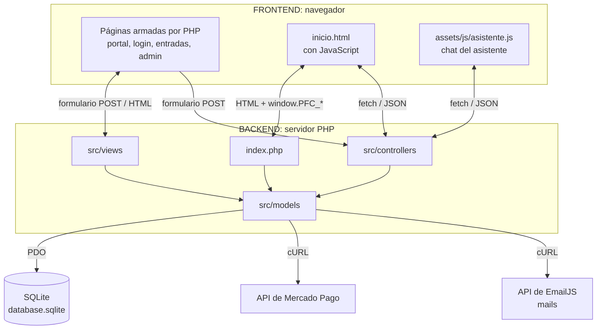

# Peritas FC — Portal de socios

Proyecto de PDISC · 7° Año 4° División · E.E.S.T. N° 4 de Berazategui.

Página del club **Peritas FC** ("el club de la tecnología"): noticias, venta de entradas con Mercado Pago,
portal del socio con cuota mensual, plantel, resultados y tabla de posiciones, asistente virtual y
panel de administración.

**Página publicada:** https://peritasfc.onrender.com

## Integrantes

- Curia Tiziano
- Maccartney Santiago
- Vera Benjamín
- Vera Thiago
- Villasboa Tobías

## Qué tiene la página

| Sección | Qué hace |
|---|---|
| **Inicio** | Banner con el próximo partido (con foto del rival) y cuenta regresiva real, noticias, sede del club y asistente virtual. |
| **Noticias** | Noticias del club con filtro Fútbol / Institucional. Las carga el admin. |
| **Entradas** | Compra de entradas por sector con **Mercado Pago**. Los socios Pleno con la cuota al día entran gratis a la Tribuna Popular. |
| **Plantel** | Jugadores del primer equipo por posición, con número y foto (se cargan desde un JSON). |
| **Resultados** | Últimos partidos de Peritas FC y **tabla de posiciones** calculada sola (3 puntos por ganar, 1 por empatar). |
| **Portal del socio** | Credencial con número de socio y **foto** (la sube el socio), cuotas mensuales (se pagan con Mercado Pago), mis entradas e **historial de pagos**. |
| **Asistente** | Responde con datos reales: próximo partido, precios, cuota del socio, cómo asociarse y la sede. |
| **Administración** | **Estadísticas** (socios, recaudación, ocupación por partido, deudores), partidos, resultados y noticias. Solo para usuarios con rol `admin`. |
| **Cuenta** | Registro (queda logueado al crear la cuenta), login, "¿Olvidaste tu contraseña?" (llega un link por mail) y salir. Si se vuelve al login con el botón "Atrás", la sesión se cierra. |

## Frontend y backend: dónde está cada cosa

- **Frontend** = lo que corre en el **navegador** del usuario: HTML, CSS y JavaScript.
- **Backend** = lo que corre en el **servidor**: PHP, la base de datos SQLite y las llamadas a Mercado Pago y EmailJS.

El código sigue la idea de **MVC** (Modelo, Vista, Controlador), sin framework:

```
Peritas-FC/
│
├── assets/                FRONTEND: archivos que el navegador descarga tal cual
│   ├── css/dala.css         Colores y tipografía del club (junto con Tailwind)
│   ├── js/asistente.js      Chat del asistente (portal, plantel, resultados y admin)
│   ├── img/                 Escudo y fotos (noticias, plantel/, partidos/)
│   └── data/                JSON que se editan sin tocar código (partidos, resultados,
│                            plantel, noticias). Los lee el BACKEND para cargar la base.
│
├── src/                   BACKEND: el código PHP que corre en el servidor
│   ├── config/              Arranque: hora, sesión, conexión a la base, .env y control de admin
│   ├── models/              Modelo: reglas del club y consultas a la base (pagos y cuotas con
│   │                        Mercado Pago, partidos, noticias, resultados, recuperar contraseña,
│   │                        foto del socio)
│   ├── controllers/         Controlador: reciben una acción (un formulario o un fetch) y
│   │                        responden JSON o redirigen (pagos, asistente, noticias, foto, salir)
│   └── views/               Vista: las páginas. El servidor las arma con los datos de la base
│       │                    y le manda al navegador solo el HTML
│       ├── inicio.html        Inicio, noticias y entradas (HTML + el JavaScript del frontend)
│       ├── portal.php         Portal del socio
│       ├── entradas.php       Comprar entradas (versión sin JavaScript)
│       ├── plantel.php        Plantel
│       ├── resultados.php     Resultados y tabla de posiciones
│       ├── auth/              Login, registro y recuperar contraseña
│       ├── admin/             Estadísticas, partidos y resultados (solo admin)
│       ├── posts/             Noticias del admin (listado y formulario)
│       └── _layouts/club.php  Encabezado y pie compartidos
│
├── index.php              BACKEND: entrada de la página, arma el inicio con datos de la base
├── router.php             BACKEND: "portero" del servidor, no deja descargar la base ni el .env
├── .htaccess              Lo mismo que router.php, pero para Apache (XAMPP)
├── schema.sql             BASE DE DATOS: las tablas (database.sqlite se crea sola y no se sube)
├── Dockerfile             SERVIDOR: arma la "caja" con PHP para Render
├── run.sh                 SERVIDOR: lo que se ejecuta al prender el servidor en Render
├── litestream.yml         SERVIDOR: dónde se guarda la copia de la base (Backblaze B2)
└── .env.example           Qué variables secretas hacen falta (el .env real no se sube)
```

Las **vistas** (`src/views`) son el punto de encuentro: son archivos PHP, así que las ejecuta el servidor
(backend), pero lo que generan es el HTML que ve el usuario (frontend). **El navegador nunca recibe el código
PHP ni la base de datos**: solo HTML, CSS, JavaScript, imágenes y respuestas JSON.

## Cómo se comunican el frontend y el backend



| Cómo | De dónde a dónde | Ejemplo en el proyecto |
|---|---|---|
| **Formulario `POST`** | Navegador → PHP (llega en `$_POST` y `$_FILES`) | Login y registro (`src/views/auth/`), foto del carnet (`src/controllers/socios/foto.php`), pagar la cuota (`src/views/portal.php`), noticias del admin (`src/controllers/posts/`) |
| **`fetch` con respuesta JSON** | JavaScript → PHP, sin recargar la página | Asistente → `src/controllers/chatbot.php`; comprar entrada → `src/controllers/pagos/crear.php` |
| **Datos inyectados `window.PFC_*`** | PHP → JavaScript | `index.php` mete el usuario, los próximos partidos y las noticias en `inicio.html` |
| **Redirección y datos en la URL** | PHP → navegador → otra página | Después de cada formulario se redirige con GET (Post/Redirect/Get); `retorno.php` vuelve con `?pago=aprobado` |
| **Sesión (`$_SESSION`)** | Entre páginas PHP del mismo usuario | `user_id` se guarda al iniciar sesión y lo revisan todas las páginas privadas |
| **PDO** | PHP → base de datos | Consultas preparadas (con `?`) en `src/models` |
| **cURL** | PHP → APIs de afuera | Mercado Pago (`src/models/mercadopago.php`) y EmailJS (`src/models/recuperar.php`) |
| **Webhook** | Mercado Pago → PHP | `src/controllers/pagos/webhook.php` |

### Ejemplo: comprar una entrada, paso por paso

1. **Frontend:** en `inicio.html` el socio elige partido y sector y toca Pagar. `processTicketPayment()` hace un
   `fetch` a `/src/controllers/pagos/crear.php` con el partido y el sector.
2. **Backend, controlador:** `crear.php` revisa que haya sesión y llama al modelo.
3. **Backend, modelo:** `crear_compra()` (`src/models/mercadopago.php`) calcula el precio **en el servidor**, guarda
   el pago pendiente en la base y le pide a Mercado Pago el link de pago (cURL).
4. **Backend → frontend:** `crear.php` responde un JSON con el link y el JavaScript manda al socio a Mercado Pago.
5. **Vuelta:** Mercado Pago lo devuelve a `src/controllers/pagos/retorno.php`, que le pregunta a la API si el pago se
   aprobó, recién ahí guarda la entrada y redirige a la página.

## Tecnologías

- **PHP 8** sin frameworks, con **PDO**.
- **SQLite** como base de datos (`database.sqlite`, se crea sola con `schema.sql`).
- **Tailwind CSS** (desde CDN) + `assets/css/dala.css` con los colores del club (negro, violeta y ámbar).
- **JavaScript** sin librerías para la página de inicio, el asistente y la cuenta regresiva.
- **Mercado Pago Checkout Pro** para cobrar entradas y cuotas (con cURL, sin librerías).
- **EmailJS** para mandar el mail de recuperar contraseña (también con cURL; el texto del mail está en una plantilla de EmailJS).
- **Docker + Render** para publicar, y **Litestream** para guardar la base en la nube (Backblaze B2).

## Cómo correrlo (Codespaces o tu compu)

1. Clonar el repo (o abrir un Codespace desde GitHub: **Code → Codespaces → Create codespace on main**).
2. Copiar `.env.example` como `.env` y poner el token de prueba de Mercado Pago:
   ```
   MP_ACCESS_TOKEN=TEST-tu-token
   ```
   El `.env` **no se sube a GitHub** (está en `.gitignore`).
3. Levantar el servidor (con el "portero" `router.php`):
   ```bash
   php -S 0.0.0.0:8000 router.php
   ```
4. Abrir la página: en Codespaces, pestaña **Ports** → puerto 8000. En tu compu, http://localhost:8000

La base `database.sqlite` se crea sola la primera vez. Si cambia `schema.sql`, borrarla (`rm database.sqlite`) para que se vuelva a crear.

Para que un usuario sea **admin**: en Render se pone su email en la variable `ADMIN_EMAIL`. En local:
```bash
php -r '$p=new PDO("sqlite:database.sqlite"); $p->exec("UPDATE users SET role=\"admin\" WHERE email=\"tu@mail.com\"");'
```

## Datos y fotos que se cambian sin tocar código

| Dónde | Para qué |
|---|---|
| `assets/data/partidos.json` | Próximos partidos y **precios de cada sector**. Al cambiarlo se actualiza la página sola. |
| `assets/data/resultados.json` | Resultados del torneo (los que vienen son **de ejemplo**). El admin también carga resultados desde el panel. En "Últimos partidos" se ven solo los de Peritas FC; los de otros equipos se usan para la tabla. |
| `assets/data/plantel.json` | Jugadores: número, nombre, posición y foto (por ejemplo `"/assets/img/plantel/jugador-9.jpg"`; vacío muestra el escudo). |
| `assets/data/noticias.json` | Noticias iniciales. Después se cargan desde **Admin → Noticias**. |
| `assets/img/partidos/` | Fotos de fondo de los partidos. Se llaman como el rival: `racing-digital.jpg`, `alianza-deportiva.jpg`. Si un rival no tiene foto se usa `general.jpg`, y si tampoco está, el fondo de cancha de siempre. |

## Pagos con Mercado Pago

1. El botón **Pagar** llama a `src/controllers/pagos/crear.php` (entradas) o al portal (cuotas). El precio se calcula **en el servidor**.
2. Se guarda un pago "pendiente" y se crea la preferencia en Mercado Pago.
3. El usuario paga y vuelve a `retorno.php`, que **le pregunta a Mercado Pago** si el pago se aprobó. Recién ahí se guarda la entrada o se marca la cuota como pagada.
4. `webhook.php` recibe los avisos de Mercado Pago (necesita una URL pública https, como la de Render).

Para probar: token de prueba, **tarjetas de prueba** de Mercado Pago y ventana de incógnito.

## Recuperar la contraseña

1. En "¿Olvidaste tu contraseña?" el socio pone su mail. La página responde siempre lo mismo, exista o no el mail, así nadie puede averiguar quién es socio.
2. Si es socio, `src/models/recuperar.php` genera un código al azar de 64 caracteres, guarda en la tabla `recuperaciones` **solo su hash** y le manda un mail (API de EmailJS) con el link a `restablecer.php`.
3. El link vence a los 30 minutos y sirve **una sola vez**. Se pueden pedir hasta 3 links por hora.
4. Sin `EMAILJS_SERVICE_ID` (en Codespaces o en tu compu) el link aparece en la terminal donde corre `php -S`, para probar.
5. En EmailJS, la plantilla usa `{{to_email}}`, `{{nombre}}` y `{{link}}`, y en **Account → Security** tiene que estar activado
   **"Allow EmailJS API for non-browser applications"** (si no, EmailJS rechaza los mails que manda el servidor).

## Publicación en Render

- Render arma la imagen con el `Dockerfile` y ejecuta `run.sh`.
- `run.sh` baja la base guardada en Backblaze (Litestream), la crea si no existe, da rol admin a `ADMIN_EMAIL` y arranca el servidor con `router.php`.
- Variables de entorno en Render (**Environment**): `MP_ACCESS_TOKEN`, `ADMIN_EMAIL`, `LITESTREAM_ACCESS_KEY_ID`, `LITESTREAM_SECRET_ACCESS_KEY`, `EMAILJS_SERVICE_ID`, `EMAILJS_TEMPLATE_ID`, `EMAILJS_PUBLIC_KEY`, `EMAILJS_PRIVATE_KEY` y `APP_URL`.
- En el plan gratis la página "se duerme" a los 15 minutos sin visitas y tarda unos segundos en despertar.

## Seguridad

- Contraseñas guardadas con `password_hash` y comprobadas con `password_verify`.
- Para recuperar la contraseña hace falta abrir el link que llega al mail del socio (vence a los 30 minutos y sirve una sola vez); no alcanza con saber su DNI.
- Consultas con PDO y parámetros (sin SQL armado a mano con datos del usuario).
- Sesiones en todas las páginas privadas; las de administración controlan que el usuario sea `admin`.
- El precio y el estado de cada pago se verifican en el servidor contra Mercado Pago.
- El token de Mercado Pago y las claves de Litestream y de EmailJS van en variables de entorno, nunca en el repo.
- `router.php` y `.htaccess` no dejan descargar la base de datos, el `.env` ni los archivos de configuración.
